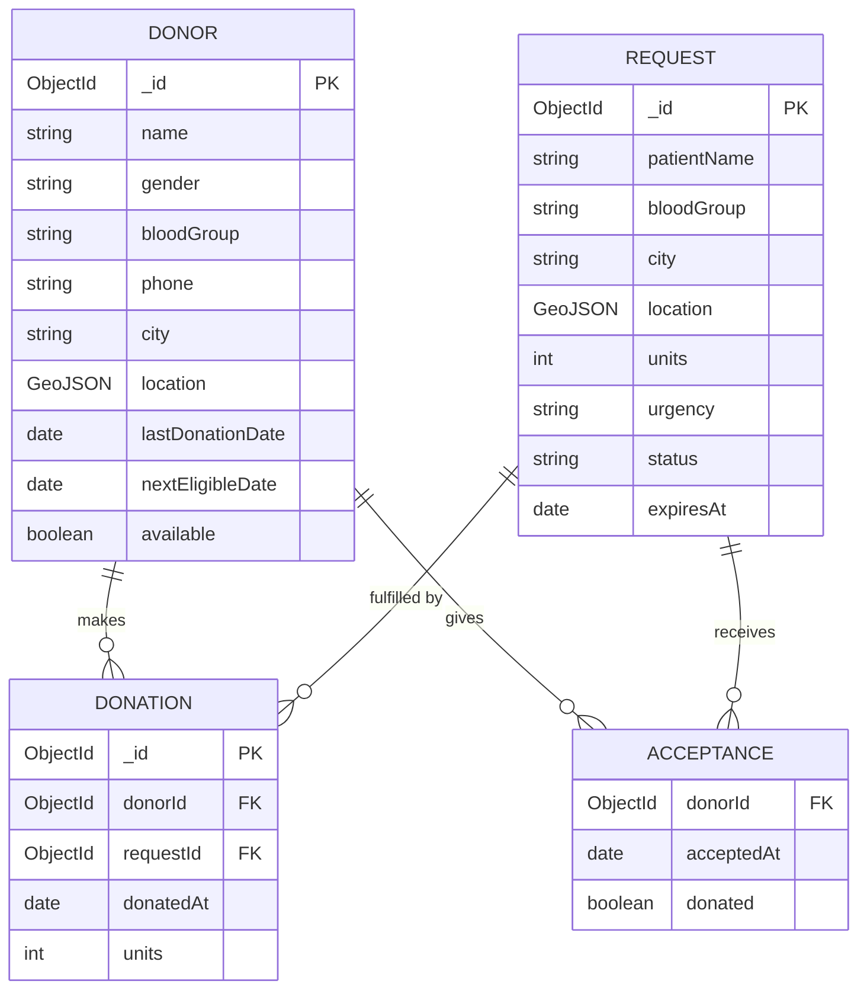

# LifeLink - Blood Donor Finder

LifeLink is a complete, minimal, live full-stack web application designed for connecting blood recipients with nearby, eligible blood donors in real-time. Built specifically as a college mini-project demonstration with zero mock/sample data, computing all compatibility, location proximity, countdowns, shortage heatmaps, and statistics dynamically from MongoDB at request time.

---

## Features

1. **Donor Registration & Profile:**
   - Registration with geolocation mapping (city center or exact GPS coordinates).
   - Dynamic eligibility countdowns: 90 days for men/other, 120 days for women.
   - Availability toggle (pause/resume emergency notifications).

2. **Recipient Search:**
   - Real-time whole blood group compatibility matching (e.g. B- recipients match B- and O- donors).
   - Geospatial `$geoNear` search showing nearest donors first.
   - Automatic search radius expansion (5 km -> 10 km -> 25 km -> 50 km) when fewer than 3 eligible donors are nearby.
   - Ineligible donors listed with amber countdown badges ("Eligible in N days") sorted after eligible donors.
   - Direct Call (`tel:`) and WhatsApp (`wa.me`) quick actions.

3. **Urgent Blood Requests:**
   - Post urgent requests with expiry times (Critical: +6h, Urgent: +24h, Normal: +72h).
   - Secret manage link (`request.html?id=<id>`) to manage requests, view accepted donor contacts, confirm donations, or cancel.
   - Donor acceptance flow revealing requester contact details.

4. **Donation Records & Atomic Updates:**
   - Log walk-in donations or requester-confirmed donations.
   - Strict eligibility guard preventing premature re-donations.
   - Updates donor's `lastDonationDate`, `nextEligibleDate`, and increments `donationCount`.

5. **Shortage Heatmap & Alerts:**
   - City x Blood Group grid comparing active demand against compatible eligible supply.
   - Auto-generated severity alert banners for critical shortages.
   - Direct click-through from grid cells to pre-filled donor search.

6. **Analytics & Reports:**
   - Total statistics (Donors, Eligible Now, Active Requests, 30-Day Donations).
   - Visual CSS bar charts for donors by group, donors by city, and most-requested blood groups.
   - Top Donors Hall of Fame leaderboard.

---

## Tech Stack

| Layer | Choice |
|---|---|
| Runtime | Node.js (v18+) |
| Backend | Express (ES Modules) |
| Database | MongoDB (Local `mongodb://127.0.0.1:27017/blood_donor_finder` or Atlas) |
| ODM | Mongoose (Built-in schema validators: `required`, `enum`, `match`, `min`, `max`) |
| Frontend | HTML5, Vanilla CSS, Vanilla JavaScript (ES Modules), served statically |
| Map | Leaflet.js + OpenStreetMap tiles via CDN (No API keys required) |
| Dev Tools | `dotenv`, `cors`, `nodemon` |

---

## Installation & Setup

1. **Clone & Install Dependencies:**
   ```bash
   npm install
   ```

2. **Environment Configuration:**
   Copy `.env.example` to `.env`:
   ```bash
   cp .env.example .env
   ```
   Default `.env` contents:
   ```env
   PORT=3000
   MONGODB_URI=mongodb://127.0.0.1:27017/blood_donor_finder
   ```

3. **Start Development Server:**
   ```bash
   npm run dev
   ```
   Open `http://localhost:3000` in your web browser.

---

## Simple Phone-Number Authentication

For simplicity in live college mini-project demos, auth uses phone-number identification:
- Registering creates a document with a unique phone index.
- Login accepts the phone number, stores the donor `_id` in browser `localStorage`, and attaches header `x-donor-id` to protected requests.
- *Note:* This is a deliberate demo simplification (no passwords or JWTs).

---

## API Summary Table

| Method | Endpoint | Description | Auth Header |
|---|---|---|---|
| `POST` | `/api/donors` | Register a new donor | None |
| `POST` | `/api/donors/login` | Login via phone number | None |
| `GET` | `/api/donors/me` | Fetch own donor profile & eligibility | `x-donor-id` |
| `PATCH` | `/api/donors/me` | Update donor profile / availability | `x-donor-id` |
| `GET` | `/api/donors/search` | Search compatible donors by blood group & location | None |
| `POST` | `/api/requests` | Create urgent blood request | None |
| `GET` | `/api/requests` | List active open blood requests | None |
| `GET` | `/api/requests/for-me` | Get matching requests near donor (within 50 km) | `x-donor-id` |
| `GET` | `/api/requests/:id` | Get request details (includes donor contacts if manage key provided) | `x-manage-key` (optional) |
| `POST` | `/api/requests/:id/accept` | Donor accepts a blood request | `x-donor-id` |
| `PATCH` | `/api/requests/:id/cancel` | Cancel blood request | `x-manage-key` |
| `POST` | `/api/donations` | Log walk-in or requester-confirmed donation | `x-donor-id` or `x-manage-key` |
| `GET` | `/api/donations/me` | List own donation history | `x-donor-id` |
| `GET` | `/api/shortage` | Get shortage heatmap grid & critical alerts | None |
| `GET` | `/api/reports/summary` | Get aggregation statistics & top donors | None |

---

## Entity-Relationship (ER) Diagram



*Note:* `ACCEPTANCE` is embedded inside `REQUEST` as an array `acceptedBy`.

---

## MongoDB Concepts Demonstrated

| Concept | Usage in LifeLink |
|---|---|
| **2dsphere Index & `$geoNear`** | Spatial index on GeoJSON points for finding nearest donors within 50 km. |
| **Aggregation Pipelines** | Dynamic calculation of `daysLeft`, dynamic `$addFields`, `$sort`, `$group`, `$lookup`, and `$limit`. |
| **Server Variable `$$NOW`** | Dynamic date calculations inside aggregation without client clock drift. |
| **Compound & Unique Indexes** | Compound index on `{ bloodGroup, city, available, nextEligibleDate }` and unique index on `phone`. |
| **TTL Index** | Automatic document expiration for old requests 30 days after `expiresAt`. |
| **Embedded Arrays** | Embedded array `acceptedBy` in `Request` model. |
| **Atomic Operations** | Atomic MongoDB updates using `$push`, `$inc`, and positional `$` operators without expensive multi-document transactions. |

---

## Future Enhancements

- OTP SMS Verification for phone numbers.
- Privacy mode: hide donor phone numbers until a request is accepted.
- Compatibility extension for Plasma and Platelet donations.
- Automated SMS / WhatsApp reminder notifications when donors become eligible again.
- Interactive map for blood donation camps and blood bank inventory integration.
