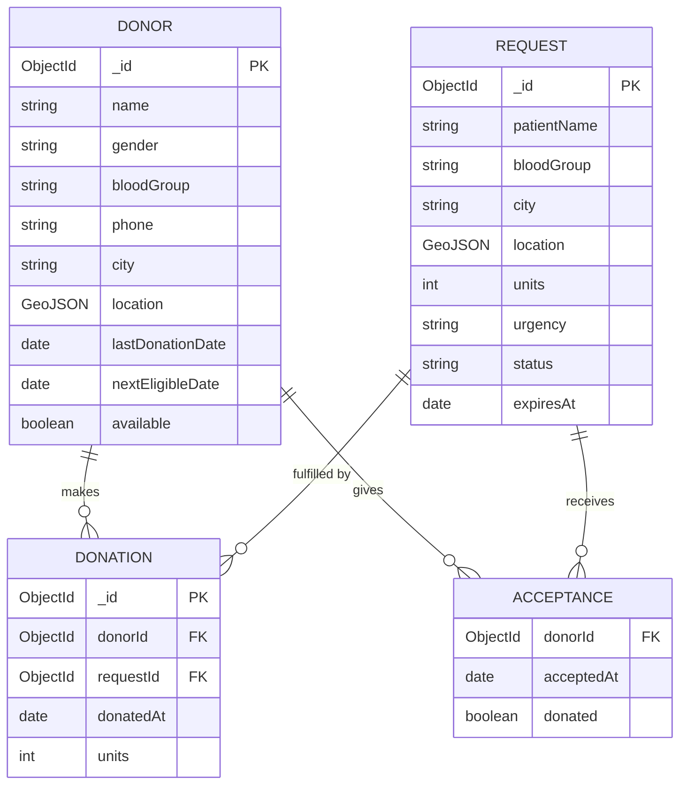

# Entity-Relationship (ER) Diagram - LifeLink Blood Donor Finder

The database consists of **3 MongoDB collections** (`donors`, `requests`, `donations`) containing **4 logical entities**, as `ACCEPTANCE` is an embedded document array (`acceptedBy`) within `REQUEST`.

> **Note:** `ACCEPTANCE` is **embedded** as an array `acceptedBy` inside the `REQUEST` document.
